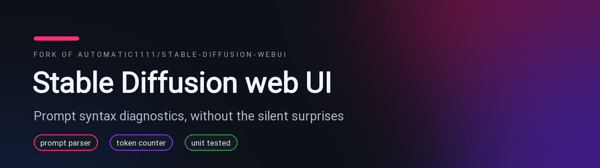

<div align="center">



# 🎨 Stable Diffusion web UI

**A browser interface for Stable Diffusion, built on Gradio — with a prompt parser that tells you when your prompt is broken.**

*— forked from [AUTOMATIC1111/stable-diffusion-webui](https://github.com/AUTOMATIC1111/stable-diffusion-webui), with prompt syntax diagnostics & a restyled page*

[](https://github.com/vincntlaw/stable-diffusion-webui/network)
[](https://github.com/AUTOMATIC1111/stable-diffusion-webui/stargazers)
[](https://www.python.org/)
[](https://gradio.app)
[](LICENSE.txt)

[](https://discord.com/users/283333002749018113)

*The Discord card above is **live** — my real presence & activity via [Lanyard](https://github.com/Phineas/lanyard).*

</div>

---

> 🍴 **This is a fork.** Stable Diffusion web UI is created and maintained by **[@AUTOMATIC1111](https://github.com/AUTOMATIC1111)** — the [upstream repository](https://github.com/AUTOMATIC1111/stable-diffusion-webui) is the authoritative home for docs, issues and releases. This fork adds the prompt-syntax work below and restyles this page. The upstream install commands are unchanged.

## 🧪 What this fork adds

**Attention weights that are not numbers used to kill the whole generation, and unbalanced brackets used to change the rest of the prompt without a word. The parser survives the first, and the token counter reports the second.**

```python
>>> from modules import prompt_parser
>>> prompt_parser.parse_prompt_attention("a (cat:1.2.3)")
ValueError: could not convert string to float: '1.2.3'    # upstream: the generation dies here
```

A weight is only a weight if it is an actual number. Anything else — `.`, `1.2.3`, `..5`, `+.` — stays in the prompt as plain text instead of reaching `float()`:

```python
>>> prompt_parser.parse_prompt_attention("a (cat:1.2.3)")
[['a ', 1.0], ['cat:1.2.3', 1.1]]
>>> prompt_parser.check_prompt_syntax("a (cat:1.2.3")
["invalid weight '1.2.3'", "unclosed '(' bracket"]
```

The warnings show up next to the token counter as a ⚠ whose tooltip lists everything wrong with the prompt, behind the new **Settings → User Interface → Prompt editing → "Show prompt syntax warnings next to the token counter"** option.

- 🛡️ **Malformed weights no longer abort a generation** — `(cat:1.2.3)` is parsed as text and reported, not raised
- 💬 **Bracket mistakes become visible** — unclosed `(`/`[` and stray `)`/`]` are listed in the tooltip
- ⚡ **Schedules are memoized** — 19.5 ms → 0.3 ms on repeated requests, with fresh lists handed to every caller
- 🧪 **The prompt parser has tests now** — 35 unit cases, plus the existing doctests
- 🔒 **No behaviour change for valid prompts** — balanced prompts parse exactly as before

| Prompt | What the token counter says |
|---|---|
| `a (cat` | `unclosed '(' bracket` |
| `a ((cat` | `2 unclosed '(' brackets` |
| `a [cat` | `unclosed '[' bracket` |
| `a cat)` | `unexpected ')' without a matching '('` |
| `a (cat:1.2.3)` | `invalid weight '1.2.3'` |

| | upstream | this fork |
|---|---|---|
| `"a (cat:.)"` | `ValueError`, generation aborted | parsed, reported as `invalid weight '.'` |
| 100,000 fuzzed prompts | — | 0 exceptions |
| repeated schedule parse | 19.5 ms | 0.3 ms |
| prompt-parser unit tests | none | 35 |

## ✨ What does it do?

It is the interface most people mean when they say "run Stable Diffusion locally": a Gradio app that loads a checkpoint, turns your prompt into conditioning, and hands the rest to the sampler. Everything except the prompt layer is upstream behaviour.

```
prompt ──► prompt_parser.py ──► CLIP text encoder ──► UNet sampler ──► VAE ──► gallery
           weights · schedules      sd_hijack_*.py      sd_samplers_*     sd_vae
```

Your settings, styles, extensions and generation parameters all live on disk, so the UI behaves the same after a restart or an update.

## 📸 Screenshot


## 🚀 Features

- ⚡ **One-click install** — `webui.sh` / `webui-user.bat` create a venv, install torch and launch the server
- 🖼️ **txt2img & img2img** — plus inpainting, outpainting and colour sketch
- 🔁 **Hires. fix** — a second high-resolution pass without the usual distortions
- 🎛️ **X/Y/Z plot** — grid comparisons across checkpoints, samplers, steps and CFG
- 🅰️ **Prompt language** — `(word:1.3)`, `[a:b:0.5]`, `[a|b]`, `AND` and `BREAK`
- 🧠 **Textual Inversion, LoRA & Hypernetworks** — embeddings and adapters loaded on the fly
- 🖌️ **Extras tab** — GFPGAN, CodeFormer, RealESRGAN, SwinIR and LDSR upscalers
- 📄 **PNG Info** — generation parameters travel inside the image and can be pasted back
- 🧩 **Extensions & custom scripts** — installable from the UI, with an [ecosystem](https://github.com/AUTOMATIC1111/stable-diffusion-webui/wiki/Custom-Scripts) around them
- 🔌 **REST API** — start with `--api` to get `/sdapi/v1/*`
- 🖥️ **Small cards welcome** — `--lowvram` / `--medvram`, with reports of 2 GB cards working
- 🌗 **Themes & localization** — light/dark themes and community translations

The full showcase, with images, lives in the upstream wiki: [Features](https://github.com/AUTOMATIC1111/stable-diffusion-webui/wiki/Features).

## 🛠️ Quick start

### Requirements

| Requirement | Notes |
|---|---|
| Python 3.10 or 3.11 | 3.10.6 is what upstream recommends; newer versions are often not covered by the pinned torch build |
| git | used by the installer and by updates |
| NVIDIA GPU *(recommended)* | AMD, Apple Silicon, Intel and Ascend NPUs work too — guides are linked below |
| ~10 GB of disk | the venv with torch, plus at least one checkpoint |

### Setup

```bash
git clone https://github.com/vincntlaw/stable-diffusion-webui
cd stable-diffusion-webui
./webui.sh          # Linux / macOS — Windows: webui-user.bat
```

The first run creates `venv/`, installs torch and the requirements, then serves the UI on <http://127.0.0.1:7860>. Put checkpoints in `models/Stable-diffusion/` and pick one from the top-left dropdown.

Launch flags belong in `webui-user.sh` (or `COMMANDLINE_ARGS` in `webui-user.bat`):

```bash
export COMMANDLINE_ARGS="--xformers --medvram --api"
```

### Platform guides

- 🪟 **Windows release package** — [v1.0.0-pre](https://github.com/AUTOMATIC1111/stable-diffusion-webui/releases/tag/v1.0.0-pre): download, `update.bat`, `run.bat`
- 🐧 **Linux** — `sudo apt install wget git python3 python3-venv libgl1 libglib2.0-0`, then `./webui.sh`
- 🍎 **Apple Silicon** — [Installation-on-Apple-Silicon](https://github.com/AUTOMATIC1111/stable-diffusion-webui/wiki/Installation-on-Apple-Silicon)
- 🔧 **Everything else** — [Dependencies](https://github.com/AUTOMATIC1111/stable-diffusion-webui/wiki/Dependencies) · [NVidia](https://github.com/AUTOMATIC1111/stable-diffusion-webui/wiki/Install-and-Run-on-NVidia-GPUs) · [AMD](https://github.com/AUTOMATIC1111/stable-diffusion-webui/wiki/Install-and-Run-on-AMD-GPUs)

## ⚙️ Prompt syntax

| Syntax | What it does |
|---|---|
| `(word)` | emphasis ×1.1 |
| `(word:1.4)` | emphasis with an explicit weight |
| `[word]` | de-emphasis ÷1.1 |
| `[from:to:0.5]` | start with `from`, switch to `to` at 50% of the steps |
| `[a\|b\|c]` | alternate per step |
| `cat AND dog` | composable diffusion — one conditioning per prompt |
| `BREAK` | force a new 75-token chunk |
| `\(` `\)` `\[` `\]` | literal brackets, not syntax |
| `(word:1.2.3)` | not a weight — kept as text, reported by the token counter |

## 🧠 How it fits together

| Where | What lives there |
|---|---|
| `webui.py` | entry point: command-line args, initialization, server launch |
| `modules/ui.py` | the Gradio interface — tabs, token counters, event wiring |
| `modules/ui_toprow.py` | the prompt box, style dropdown and token counter widgets |
| `modules/prompt_parser.py` | attention weights, `[a:b:step]` scheduling, `[a\|b]` alternation, composable `AND` |
| `modules/processing.py` | the `StableDiffusionProcessing` pipeline shared by the UI and the API |
| `modules/sd_hijack*.py` | hooks that make long prompts, weights and LoRAs work inside the model |
| `modules/sd_samplers*.py` | sampler and scheduler implementations |
| `modules/script_callbacks.py` | the extension points every custom script builds on |
| `modules/api/api.py` | the REST API behind `--api` |

## ✅ Tests

```bash
python -m modules.prompt_parser          # doctests, no GPU and no torch needed
pytest test/test_prompt_parser.py -q     # 35 unit tests for the prompt language
```

The rest of `test/` is an integration suite that talks to a running webui over HTTP.

## ⚠️ Disclaimer

This fork is not affiliated with or endorsed by AUTOMATIC1111 or Stability AI. Model weights are **not** part of this repository — every checkpoint keeps its own license, so check it before you publish anything you generate. Use the API and the extensions you install at your own risk; the webui can run arbitrary Python when started with `--allow-code`.

## 🙏 Credits & License

- Original project and maintenance: **[@AUTOMATIC1111](https://github.com/AUTOMATIC1111)** → [upstream repository](https://github.com/AUTOMATIC1111/stable-diffusion-webui)
- Upstream documentation: [wiki](https://github.com/AUTOMATIC1111/stable-diffusion-webui/wiki) · [CHANGELOG](CHANGELOG.md)
- Licenses for borrowed code: `Settings → Licenses`, also in [`html/licenses.html`](html/licenses.html)
- License: **AGPL-3.0** — see [LICENSE.txt](LICENSE.txt) © AUTOMATIC1111

<div align="center">

**[💬 Find me on Discord](https://discord.com/users/283333002749018113)** · fork restyled with ❤️

</div>
